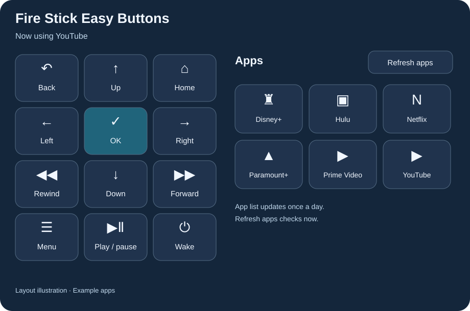

# Fire Stick Easy Buttons

Large touch controls and an A–Z app launcher for Amazon Fire TV in Home Assistant.



The remote sits on the left and app buttons sit on the right on wide displays. On phones, apps appear below the remote. The app list checks once per day and can be refreshed manually. The current app follows the media player state reported by Home Assistant.

## 1. Connect your Fire Stick

1. Connect the Fire Stick and Home Assistant to your home network.
2. On the Fire Stick, open Settings → My Fire TV → Developer Options and enable ADB Debugging. If Developer Options is hidden, open About and select the device name seven times, then return to My Fire TV.
3. In Home Assistant, open Settings → Devices & services → Add integration → Android Debug Bridge.
4. Enter the Fire Stick's local IP address. Find it under Settings → My Fire TV → About → Network.
5. Accept the ADB authorization prompt on the TV for your Home Assistant computer.
6. Confirm the integration creates a media player. Open its settings to find the entity ID, such as media_player.bedroom_fire_tv.

Refer to the [official Android Debug Bridge instructions](https://www.home-assistant.io/integrations/androidtv/) for device and connection details. Keep ADB access within your trusted home network.

## 2. Install the card from Marketplace

[Open Fire Stick Easy Buttons in Marketplace](https://my.home-assistant.io/redirect/marketplace_repository/?owner=zetayn&repository=fire-stick-easy-buttons&category=plugin)

1. Open Home Assistant → Settings → Marketplace.
2. Choose Add from link.
3. Paste https://github.com/zetayn/fire-stick-easy-buttons.
4. Connect GitHub if prompted, then install Fire Stick Easy Buttons as Dashboard content.
5. Reload the browser.

On older installations with HACS, choose HACS → menu → Custom repositories, paste the repository URL, select Dashboard, and download.

A custom repository can be installed before it is accepted into the searchable catalog.

## 3. Add it to your dashboard

1. Open your dashboard and choose Edit dashboard.
2. Choose Add card and search for Fire Stick Easy Buttons.
3. Choose your Fire Stick's media player from Android Debug Bridge.
4. Enter a title if desired, then save.

For a wide Chromebook view, give the card a full-width section. It also adapts to phone screens.

You can use the YAML editor instead:

```yaml
type: custom:fire-stick-easy-buttons
title: Fire Stick Easy Buttons
entity: media_player.your_fire_stick
discover_apps: true
```

Replace media_player.your_fire_stick with your own entity ID.

## Manual installation

1. Copy fire-stick-easy-buttons.js into the www folder in your Home Assistant configuration directory.
2. Open Settings → Dashboards → menu → Resources.
3. Add /local/fire-stick-easy-buttons.js?v=1.0.0 with resource type JavaScript module.
4. Reload your browser and add the card as above.

Advanced Mode in your Home Assistant profile may be needed to see Resources.

## App buttons

The card asks Fire TV for its launchable TV apps. Buttons sort alphabetically. Choose Refresh apps after installing an app on the Fire Stick, or let the daily check pick it up when the dashboard is open.

To rename an app, choose a different icon, or supply a package that discovery missed, add apps in the YAML editor:

```yaml
type: custom:fire-stick-easy-buttons
entity: media_player.your_fire_stick
discover_apps: true
apps:
  - name: YouTube
    package: com.amazon.firetv.youtube
    icon: mdi:youtube
  - name: Netflix
    package: com.netflix.ninja
    icon: mdi:netflix
```

An optional component field can identify an exact launcher activity, such as com.example.app/.MainActivity. Package IDs differ between apps and devices.

Set discover_apps: false to use only the apps you configure.

## Controls and updates

- Back, directional arrows, OK, Home, Menu, rewind, forward, play/pause, and wake use Android Debug Bridge commands.
- App discovery runs at most once per day per loaded card. The successful app list is cached in that browser for that device.
- Refresh apps checks immediately.
- Current app display updates when Home Assistant reports a different app_id.
- A command-sent message confirms Home Assistant accepted the request. Check your TV for the physical result.
- App icons use Home Assistant's built-in icons. The card has no external image dependency.

## Troubleshooting

**The buttons do nothing.** Check that your selected media player belongs to Android Debug Bridge. Wake the Fire Stick and check for an ADB authorization prompt on the TV. Confirm a basic command works from Home Assistant's Developer Tools.

**The current app looks delayed.** The card uses the state supplied by Android Debug Bridge. Check that integration's state detection and polling configuration.

**No apps appear.** Wake the Fire Stick and choose Refresh apps. Some Fire OS versions handle activity discovery differently. Configure app package IDs manually if needed.

**An app button fails.** Check that the app is installed for the current Fire TV profile. A discovered launcher component is used when available. App profile choosers may need a selection on the TV.

**The card is missing.** Confirm the resource is loaded as a JavaScript module, reload the browser, and check the resource URL.

## Publish this project

See [PUBLISHING.md](PUBLISHING.md) for the complete GitHub and Marketplace directions.

## Development and verification

The distributed JavaScript is the source. There is no build step.

```sh
node --check fire-stick-easy-buttons.js
node --test card.test.cjs
```

preview.html runs a simulated Fire Stick and makes no Home Assistant calls. Serve this folder with a local web server to try the layout. The README image is an illustration of the layout.

The automated tests cover app parsing, unsafe package rejection, command targets, daily refresh, device switching during discovery, and ADB error feedback. Physical Fire Stick validation is required before a public release.

## License

MIT. Amazon, Fire TV, and app names are trademarks of their respective owners. This is an independent Home Assistant community card.


